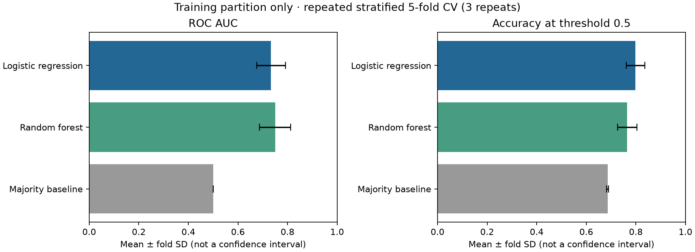
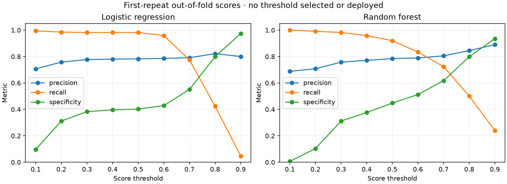

# Loan Eligibility Prediction

An educational classification project with a Streamlit demo, complete scikit-learn pipelines, and reproducible evaluation. It compares Logistic Regression and Random Forest against a majority-class baseline on the bundled 614-row CSV.

[Streamlit demo](https://loan-eligibility-prediction-djdstcprojdapfxugpdqwi.streamlit.app/) · [Serving release](models/serving/v1/manifest.json) · [Model notes](docs/model-notes.md) · [Evaluation report](reports/baseline/metrics.json)

## What this project demonstrates

- Splitting raw data before fitting imputation, scaling, or category encoding.
- Keeping preparation and classification in one pipeline for both training and inference.
- Comparing a fixed holdout with repeated training-only cross-validation and a simple baseline.
- Shipping a versioned serving release with schema, checksums, package versions, and metrics for the exact loaded models.
- Validating form inputs and exercising both classifiers through Streamlit application tests.

The target is the CSV's historical `Loan_Approved` Y/N label. A model score is **not** a lender approval probability or decision. Source, currency, geography, and collection period remain unverified.

## Run locally

Use Python 3.11 or 3.12:

```bash
git clone https://github.com/AhmedOT22/Loan-Eligibility-Prediction.git
cd Loan-Eligibility-Prediction
python -m venv .venv
# macOS/Linux:
source .venv/bin/activate
# Windows PowerShell instead: .venv\Scripts\Activate.ps1
python -m pip install -r requirements.txt
streamlit run app.py
```

The app loads the committed `models/serving/v1` release. No training or processed CSV is required at startup. It verifies the artifact checksum, raw feature/category schema, and scikit-learn version before loading a pipeline. Checksums detect accidental mismatch; they do not make untrusted pickle files safe. Load only trusted artifacts.

The serving environment pins scikit-learn 1.4.2, Streamlit 1.50.0, and PyArrow 20.0.0 with NumPy 1.x. Exact build versions are recorded in the manifest. Hosted demo availability has not been verified; the application flows were tested locally.

## Preparation and serving

Raw applications are split 80/20 with stratification and seed 42. Each candidate owns its fitted preparation:

1. Numeric median imputation and MinMax scaling, fitted on training rows.
2. Categorical mode imputation and one-hot encoding, fitted on training rows.
3. Logistic Regression or a seeded 100-tree Random Forest.

`Loan_ID` and the target are excluded from inputs. The app uses the same complete pipelines evaluated below, fitted on the **491 training rows only**. It does not refit on all 614 rows after evaluation. The 123-row holdout stays outside every fitting step.

The serving adapter requires exactly eleven complete raw fields and checks category membership, finite non-negative numeric values, positive loan amount/term, and binary credit history. It never fits preprocessing at inference. Candidate encoders can transform unseen categories; the app deliberately rejects unsupported categories before that step.

## Holdout results for the serving pipelines

| Model | Accuracy | Precision | Recall | F1 | ROC AUC |
| --- | ---: | ---: | ---: | ---: | ---: |
| Logistic Regression | 85.37% | 0.832 | 0.988 | 0.903 | 0.852 |
| Random Forest | 82.11% | 0.846 | 0.906 | 0.875 | 0.781 |
| Majority baseline | 69.11% | 0.691 | 1.000 | 0.817 | 0.500 |

Positive class means `Loan_Approved = Y`. The holdout contains 123 rows, including 85 positives. Precision, recall, and F1 refer to that class. Logistic Regression records 17 false positives and one false negative: high positive recall does not mean strong identification of negatives.

[Exact aggregate metrics and confusion matrices](reports/baseline/metrics.json) · [Split metadata](reports/baseline/run.json) · [Serving artifact identities and matching metrics](models/serving/v1/manifest.json)

Tests recompute the holdout metrics from each committed serving artifact and compare them with both the manifest and report. These results now describe the models loaded by the app, rather than separate candidates. The old encoded estimators and scaler remain untouched as legacy artifacts and are not loaded by the current app.

## Validation beyond one split

On only the 491 training rows, three repeats of stratified five-fold CV refit the complete pipeline in each fold. Candidates and threshold 0.5 are fixed, without parameter search. For validation, the majority classifier predicts the common label and uses training-fold class proportions as its scores.

| Model | Mean accuracy ± fold SD | Mean ROC AUC ± fold SD | Mean specificity | Mean Brier score ↓ |
| --- | ---: | ---: | ---: | ---: |
| Logistic Regression | 79.83% ± 3.71 pp | 0.734 ± 0.058 | 0.399 | 0.161 |
| Random Forest | 76.51% ± 3.85 pp | 0.750 ± 0.063 | 0.440 | 0.172 |
| Majority baseline | 68.64% ± 0.41 pp | 0.500 ± 0.000 | 0.000 | 0.215 |



The 85.37% holdout accuracy is more favorable than Logistic Regression's cross-validation mean. Logistic Regression leads on average accuracy and Brier score; Random Forest leads slightly on ROC AUC. Both struggle to identify negatives at threshold 0.5. Fold SD describes variation across overlapping folds, **not** a confidence interval or statistical superiority.



Threshold diagnostics pool only the first repeat, so each training row contributes once. No threshold was optimized or deployed. Brier scores diagnose probability error; no calibrator was fitted. [Validation metrics](reports/validation/metrics.json) and [settings](reports/validation/run.json) contain aggregates only.

## Reproduce or build a new release

```bash
python -m pip install -r requirements-dev.txt
python train_model.py
python evaluate_model.py
# Optional candidate pipeline exports, separate from app artifacts:
python train_model.py --output reports/latest/candidate --save-models
# Build a complete serving release under an ignored local report path:
python build_serving.py
```

`train_model.py` writes aggregate metrics, local per-row diagnostics, and split metadata under ignored `reports/latest/`. `evaluate_model.py` exports aggregate validation statistics and real figures. Neither command changes the app's models.

`build_serving.py` fits and evaluates fresh pipelines, saves compressed artifacts and aggregate metadata, then reloads and checks them before publishing the new directory. Its default output is `reports/latest/serving-v1`. It refuses to overwrite an existing directory and exports no per-applicant labels, scores, or split indices. To prepare a different release, pass an unused `--output` directory. Review its metrics and application compatibility before changing `SERVING_DIR`; see [release and rollback instructions](docs/model-notes.md).

## Data scope and limitations

`data/raw/credit.csv` has 614 rows:

- Categorical: `Gender`, `Married`, `Dependents`, `Education`, `Self_Employed`, `Property_Area`.
- Numeric: `ApplicantIncome`, `CoapplicantIncome`, `LoanAmount`, `Loan_Amount_Term`, `Credit_History`.
- Target: `Loan_Approved`, encoded from Y/N.

No source URL or original publisher has been verified, so no UCI attribution is claimed. Amounts retain the supplied numeric scale. The dataset does not establish representativeness, independent applicants, or an actual lender's policy. Demographic inputs and historical labels require review before any real use. Random splits and CV do not establish future performance, fairness, calibration, or legal suitability.

## Tests and checks

```bash
python -m pytest -q
python -m pylint $(git ls-files '*.py')
```

Tests cover training boundaries, legacy compatibility, aggregate evaluation, exact serving/report metric agreement, checksum/version failure, invalid inputs, and both real Streamlit form flows. Application tests compare the rendered gauge score with a direct prediction from the selected release and run from another working directory. CI installs project dependencies and runs tests and full Pylint checks.

[MIT License](LICENSE) · [Ahmed Ouazzani](https://github.com/AhmedOT22)
